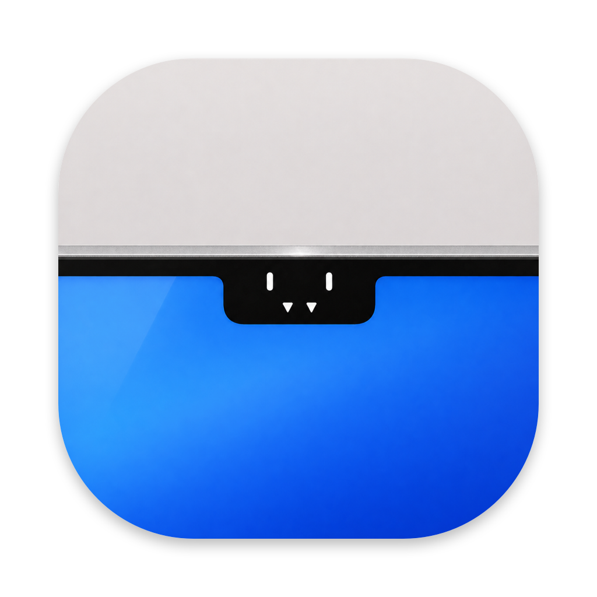

<p align="center"></p>

<h1 align="center">Oh My Notch!</h1>

<p align="center">
Uma ilha dinâmica para o notch do MacBook — e a única que protege a sua audição.<br>
<em>A Dynamic Island for your MacBook's notch — and the only one that protects your hearing.</em>
</p>

<p align="center"><strong>v0.1.0-alpha</strong> · macOS 14+ · Apple Silicon · leve (~2% de CPU, ~3 MB)</p>

> ⚠️ **Alpha.** Funciona no dia a dia do autor, mas ainda pode ter bugs. Relatos e ideias são muito bem-vindos em *Issues*.

---

## O que ele faz

**Na ilha**
- 🎵 **Música** — capa, controles e fila do Spotify e do app Música. Ondinhas ao lado do notch enquanto toca; clique na capa para expandir.
- 📅 **Calendário** — data e próximos compromissos quando nada está tocando.
- ✅ **Tarefas** — suas tarefas do app **Lembretes**: marque como feita ou crie uma nova direto no notch (vai para o Lembretes de verdade).
- ⏱️ **Timer** — atalhos de 1/5/10/25 min; enquanto conta, fica nas asas ao lado do notch.
- 🗂️ **Estante** — arraste arquivos até o notch e arraste de volta para onde quiser. Prints novos entram sozinhos, **da pasta que o seu Mac já usa** (ou outra que você escolher).
- 📊 **Sistema** (opcional) — CPU, memória e bateria. Só mede com a aba aberta.
- 🔋 **Carregamento e bateria** — aviso ao conectar o carregador e quando a bateria fica fraca.
- 🔔 **Notificações estilo iPhone** (experimental, precisa de Acessibilidade).
- 🤖 **Claude Code** — mostra o que o Claude está fazendo e avisa, com calma, quando ele espera sua resposta.
- Várias atividades ao mesmo tempo: a principal fica nas asas e a segunda vira um ícone no fim da asa.

**Fones e audição**
- 🛡️ **Proteção auditiva** — limita o volume nos fones a um nível seguro (como no iPhone e no Galaxy).
- 🎧 Bateria dos fones com anel no cantinho da ilha e animação de conexão.
- 🔊 Avisos de volume e brilho saindo do notch como uma gota, no lugar do quadrado do macOS.
- 🔒 Widget na tela de bloqueio com a música e a bateria dos fones.

**Do seu jeito**
- Aba **Recursos** nos Ajustes: ligue só o que você usa.
- Português e inglês.
- Segue o monitor externo (pílula no topo central em telas sem notch).

## Instalar

### Baixar (mais fácil)
1. Baixe o `.zip` em [Releases](../../releases) e arraste **Oh My Notch!.app** para **Aplicativos**.
2. O app ainda não é assinado pela Apple. Na primeira vez, clique com o botão direito no app → **Abrir** → **Abrir**.
   Se o macOS disser que o app "está danificado", rode no Terminal:
   ```bash
   xattr -dr com.apple.quarantine "/Applications/Oh My Notch!.app"
   ```

### Compilar você mesmo
Precisa só das ferramentas de linha de comando do Xcode (`xcode-select --install`).
```bash
git clone https://github.com/joaopedrobs-0/oh-my-notch.git
cd oh-my-notch
./build.sh            # compila e instala em /Applications
./build.sh --no-install
```

## Permissões (todas opcionais)
| Permissão | Para quê |
|---|---|
| Automação (Spotify / Música) | mostrar e controlar a música |
| Calendários | próximos compromissos |
| Lembretes | aba Tarefas |
| Pasta Mesa (ou a pasta dos prints) | prints na Estante |
| Acessibilidade | esconder o aviso de volume/brilho do macOS e ler notificações |

> Como o app não é assinado, o macOS pode pedir a Acessibilidade de novo depois de cada atualização.

## Claude Code no notch (opcional)
Copie o hook e adicione ao seu `~/.claude/settings.json`:
```bash
mkdir -p ~/.ohmynotch && cp claude-hook.sh ~/.ohmynotch/ && chmod +x ~/.ohmynotch/claude-hook.sh
```
```json
{
  "hooks": {
    "UserPromptSubmit": [{ "hooks": [{ "type": "command", "command": "~/.ohmynotch/claude-hook.sh", "timeout": 5 }] }],
    "PreToolUse": [{ "matcher": "*", "hooks": [{ "type": "command", "command": "~/.ohmynotch/claude-hook.sh", "timeout": 5 }] }],
    "Notification": [{ "hooks": [{ "type": "command", "command": "~/.ohmynotch/claude-hook.sh", "timeout": 5 }] }],
    "Stop": [{ "hooks": [{ "type": "command", "command": "~/.ohmynotch/claude-hook.sh", "timeout": 5 }] }]
  }
}
```

## Música de qualquer app (opcional, avançado)
Desde o macOS 15.4 a Apple bloqueia apps comuns de ler "o que está tocando". O projeto aberto
[mediaremote-adapter](https://github.com/ungive/mediaremote-adapter) (BSD-3) contorna isso usando o `/usr/bin/perl` do sistema.
Se quiser, rode uma vez `./setup-musica-universal.sh` e depois `./build.sh`. Sem isso, o app usa Spotify e Música normalmente.

## Créditos
- [mediaremote-adapter](https://github.com/ungive/mediaremote-adapter) — BSD-3-Clause (código em `Vendor/`, com a licença original).
- Técnica de janela na tela de bloqueio inspirada em [SkyLightWindow](https://github.com/Lakr233/SkyLightWindow) (MIT).
- Feito com a ajuda do [Claude Code](https://claude.com/claude-code).

## Licença
[MIT](LICENSE)

---

### English (short)
**Oh My Notch!** turns your MacBook's notch into a Dynamic Island: music, calendar, Reminders tasks, timer, file/screenshot shelf,
system stats, charging alerts, iPhone-style notifications, Claude Code activity — plus **hearing protection** that caps headphone volume,
headphone battery, and liquid volume/brightness indicators. Pick only the features you want in **Settings → Features**.
Download from [Releases](../../releases) (right-click → Open the first time, since it isn't notarized yet) or build with `./build.sh`. MIT licensed.
